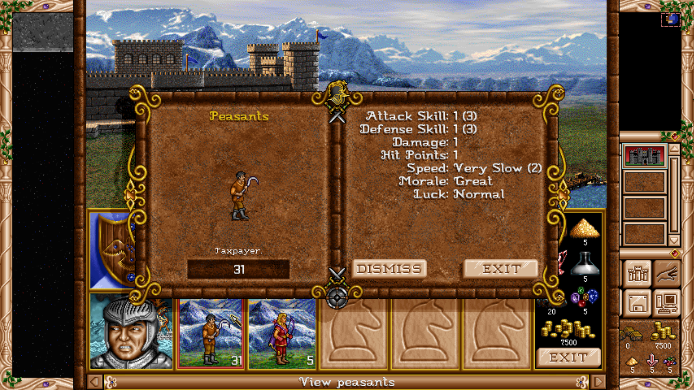
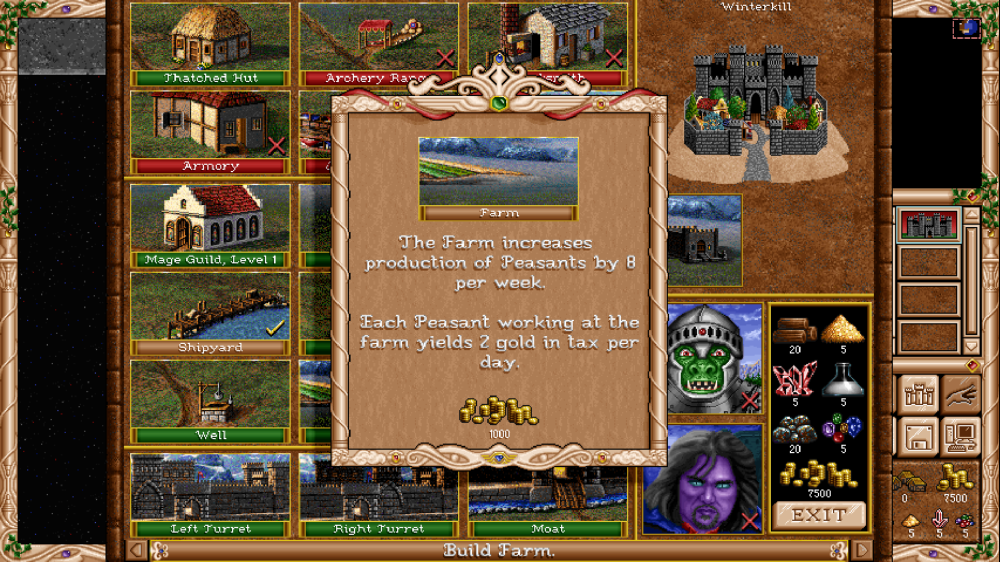
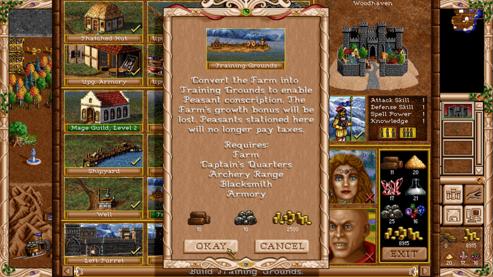
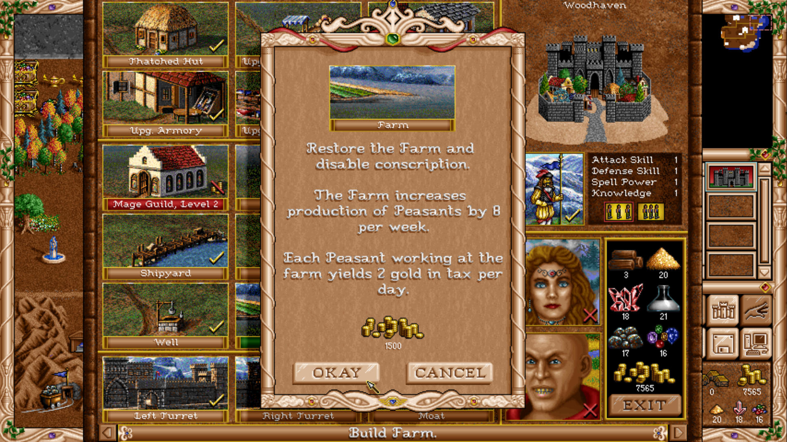
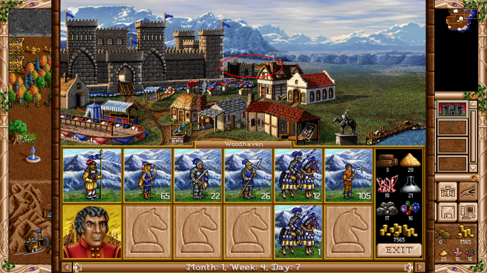
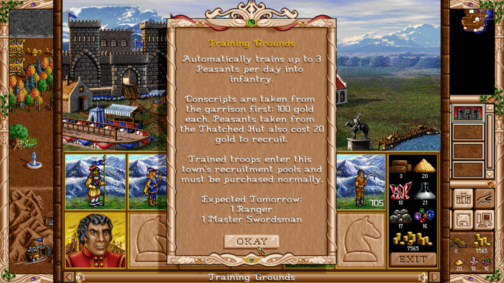

Knight Mod is an experimental mod for **fheroes2** that gives the Knight faction a population to manage: keep Peasants for tax income, or mobilize them to expand infantry recruitment.

This first Knight Mod beta brings together the previously released **Taxpayer** mechanic and **Peasant Conscription**, with dedicated computer player support, translations and further fixes. The AI has been adapted to use both mechanics, though its decisions remain imperfect.

## Taxpayer

By default, each Peasant stationed in a **Knight town or castle with a Farm** generates **2 gold per day**. Peasants in the garrison and in a visiting hero's army count together. Taxes are collected at the start of each new day.

| Peasant ability | Farm description |
| --- | --- |
|  |  |

## Peasant Conscription

A Farm can be converted into **Training Grounds (TG)** and back. Training runs automatically each day. At the default settings, a full week can turn **17 Peasants into 8 Archers, 5 Pikemen and 4 Swordsmen**.

Training costs **100 gold per Peasant**, with the normal Peasant recruitment price added when conscripts are taken directly from the Thatched Hut. The soldiers produced enter the town's recruitment pools and **must still be purchased at their usual price**. Dwelling upgrades apply to these recruits too.

While converted to TG, the Farm loses its Peasant growth bonus and the town's Peasants generate no taxes. With several Knight towns, some can retain Farms while others provide military recruits.

| Farm to Training Grounds | Training Grounds back to Farm |
| --- | --- |
|  |  |

| Training Grounds in town | Training information and expected recruits |
| --- | --- |
|  |  |

## Experimenting with balance

Finding the right balance is the main purpose of this beta. **knight_mod.ini** exposes 32 settings covering taxation, an optional taxpayer cap per Farm, conversion costs, building requirements, training fees, daily limits, success rate and unit composition. Restart the game after changing them.

The package includes **English and French Readme files and PDF testing and balance guides**, with clickable contents and a complete INI reference. The guides explain how the mechanics work and suggest ways to assess when conscription is worth using.

## Download and installation

Download **fheroes2_KM-1.0b_Windows.zip** from the assets below. It contains the **Windows x86 and x64 packages**, documentation and licence.

1. Close the game and choose the inner package matching your existing fheroes2 installation: **x86 for 32-bit, x64 for 64-bit**.
2. Extract that package into the fheroes2 installation folder, preserving the folder structure. Allow replacements when updating Knight Mod, and approve administrator permission if Windows requests it.
3. Launch **fheroes2KM.exe**.

A working fheroes2 installation with the original Heroes II data is required. **Knight Mod is based on fheroes2 1.1.17**. It can be installed alongside a later version, but its separate executable does not include later engine improvements. The original game data is not included.

The mod uses separate executable, resource and translation filenames. Each architecture includes **Uninstall_KM.bat**, with administrator elevation and an optional prompt to remove personal settings. This is the normal player build, with Knight diagnostics and observer access disabled.

**Save precaution:** Knight Mod uses the same default save folder as fheroes2 and can overwrite existing autosaves and quicksaves. Save them under other names first. Saves written by Knight Mod cannot be loaded by the original fheroes2 executable.

## Feedback

Reply wherever this beta was found, contact **conglomera7769 on Discord** or **u/illustrious_cup8442 on Reddit**, or use the project's [GitHub issues](https://github.com/Conglomera1/fheroes2/issues).

Ideas and suggestions for improving the mod are especially welcome!

---

Designed and directed by **Conglomera**. Code and analysis developed with ChatGPT assistance.

Thanks to the **fheroes2 Resurrection team** for bringing Heroes II back to life and for the work and passion they continue to put into it.

Archive SHA-256: `b16f2f673498a14d66504ef7421a4246c24ddb94a7169806cf08e3598807bddd`.
