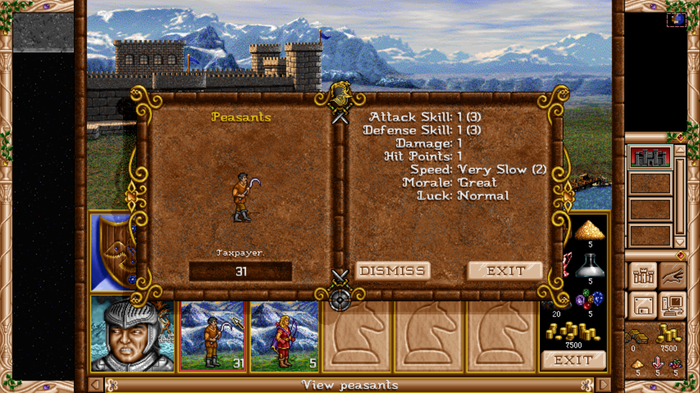
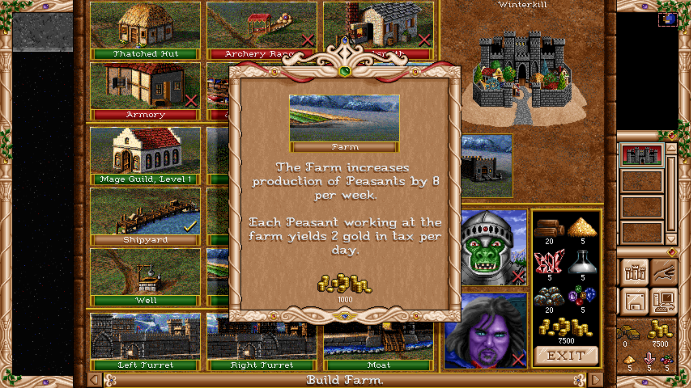
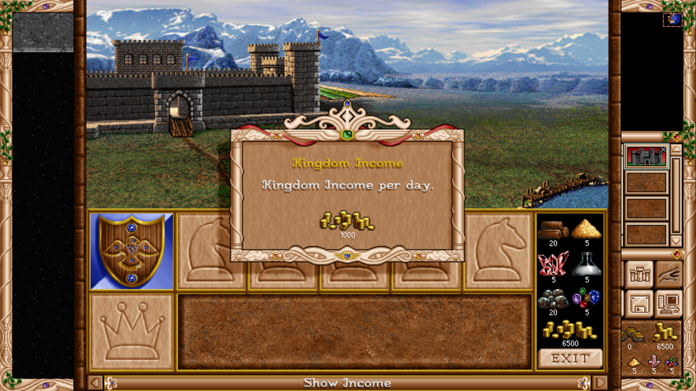
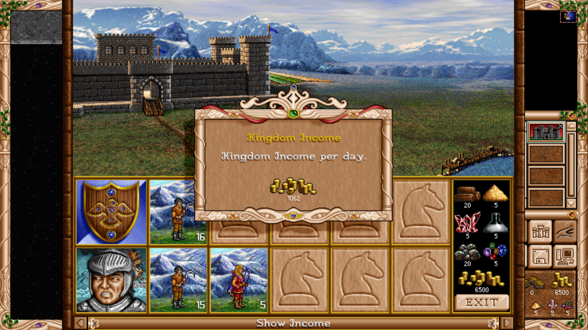
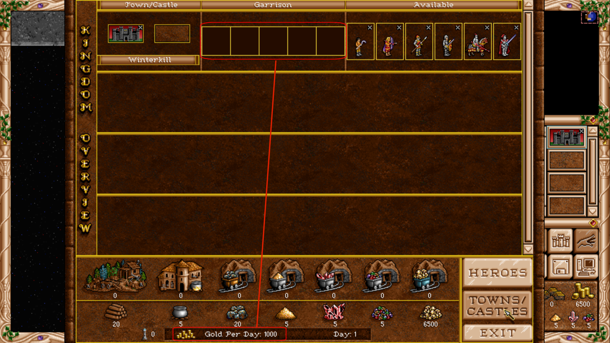
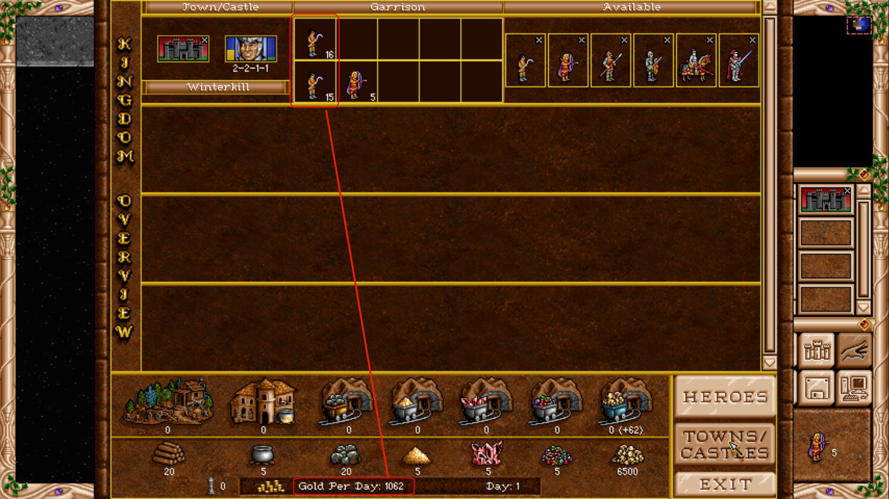

First public beta of Peasant Taxpayer for fheroes2 1.1.17.

Peasants stationed in a Knight town or castle with a Farm earn 2 gold per day by default. Tax rate and Farm requirement are configurable. Includes interface integration, translations and AI adaptations for managing taxpayers. Conscription is planned separately and is not included.

### Taxpayer in the game

| Peasant ability | Farm description |
| --- | --- |
|  |  |

### Income with and without taxpayers

With a Farm built, **16 Peasants in the garrison + 15 in the stationed hero's army = 31 taxpayers**, generating **62 gold per day** at the default rate. Total daily income rises from **1,000 to 1,062 gold**, as shown in both views.

| Without taxpayers: 1,000 gold/day | With 31 taxpayers: 1,062 gold/day |
| --- | --- |
|  |  |
|  |  |

Download **fheroes2_PTP-1.0b.zip** below. It contains Readme.txt, LICENCE, and the Windows x86 and x64 packages. Choose the package matching your existing fheroes2 installation, extract it into that folder while preserving the directory structure, and launch the PTP executable. Original Heroes II data is required and is not included.

The PTP executable, translations and resource file use separate names. Each Windows package includes Uninstall_PTP.bat. See Readme.txt for installation, configuration and removal instructions.

Windows x86 installation, gameplay and removal were tested on Windows 7. Both architectures passed build and package checks; x64 still needs confirmation from players.

Feedback on balance and AI behavior is welcome. Please include the map, difficulty, tax settings and game day.

Archive SHA-256: `fd8626bdc0ccbdab25370f946bd54a5d806d13e2a29da9c58f53f1d01b6e8b3e`.
